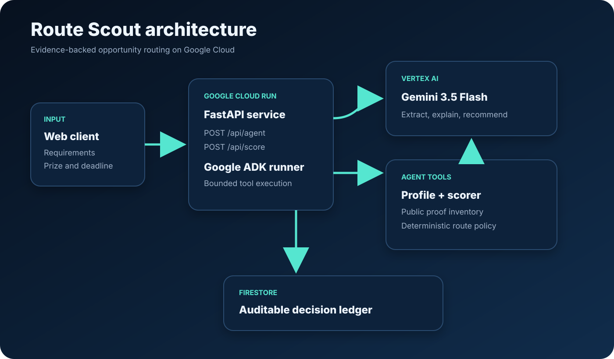

# Route Scout

Route Scout is a new Google ADK agent built during the All Things Agentic 2026
submission period. It turns noisy hackathons, bounties, and contract listings into
an evidence-backed execution route: `build_now`, `verify_first`, or `skip`.

It solves a real solo-developer friction: the expensive part is not finding more
links. It is extracting the requirements, comparing them to proof that already
exists, noticing hard blockers, and committing limited build time to the right
route before the deadline.



## Scope within the portfolio

Route Scout focuses on selecting an execution route against an operator's existing proof inventory. [Revenue Sentinel](https://github.com/jblaz6335/revenue-sentinel) focuses on evidence gates, expected-value ranking, and digest-addressed audit records. They explore related opportunity-triage problems through separate implementations.

## Required stack

- Gemini 3.5 Flash (`gemini-3.5-flash`)
- Google Agent Development Kit 2.7.1
- Google Cloud Run
- Firestore in production, memory store for offline tests
- FastAPI and Python 3.13

## Product boundary

Route Scout records decisions, not applications. Its model-facing tools can read
the operator profile and score a route. They cannot register, bid, spend, submit,
send messages, or claim revenue. External actions remain outside the agent.

## Run locally

```powershell
py -3.13 -m venv .venv
.venv\Scripts\python -m pip install -e ".[dev]"
.venv\Scripts\python -m uvicorn main:app --reload
```

Open `http://127.0.0.1:8000` and choose **Run verified demo set**. Score a
route, then choose **Ask Gemini to explain** to exercise the live ADK runner.

Run the test suite:

```powershell
.venv\Scripts\python -m pytest
```

## Run the ADK agent

Copy `.env.example` to `.env`, set a Google Cloud project with Vertex AI access,
then run the standard ADK development UI from the repository's parent directory:

```powershell
adk web
```

Select `route_scout` and ask it to evaluate one opportunity. The agent first reads
the verified proof inventory and then calls the deterministic scoring tool.

The public FastAPI surface also exposes `POST /api/agent`. It runs the same
`root_agent` through ADK's runner, returns the final Gemini explanation, and keeps
application, spending, and messaging actions outside the agent boundary.

## Deploy to Cloud Run

The production service uses Firestore when `ROUTE_SCOUT_STORE=firestore`.

```powershell
gcloud run deploy route-scout --source . --region us-central1 \
  --allow-unauthenticated \
  --set-env-vars ROUTE_SCOUT_STORE=firestore,GOOGLE_GENAI_USE_VERTEXAI=TRUE,GOOGLE_CLOUD_LOCATION=global
```

The Cloud Run service account needs Firestore access and Vertex AI User. Use a
dedicated Google Cloud project so the submission can be audited and removed
without affecting unrelated workloads.

## New-project disclosure

All source in this repository was created during the contest period. The project
uses public links to earlier Blaz Algo Systems work only as portfolio evidence;
no source code from those projects is incorporated here.

The working Devpost copy and four-minute demo outline are in
[`docs/submission.md`](docs/submission.md).
